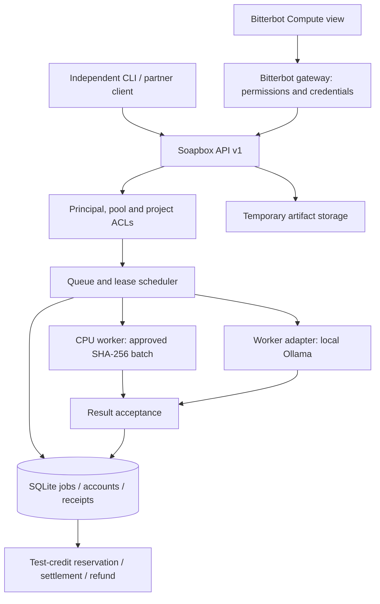
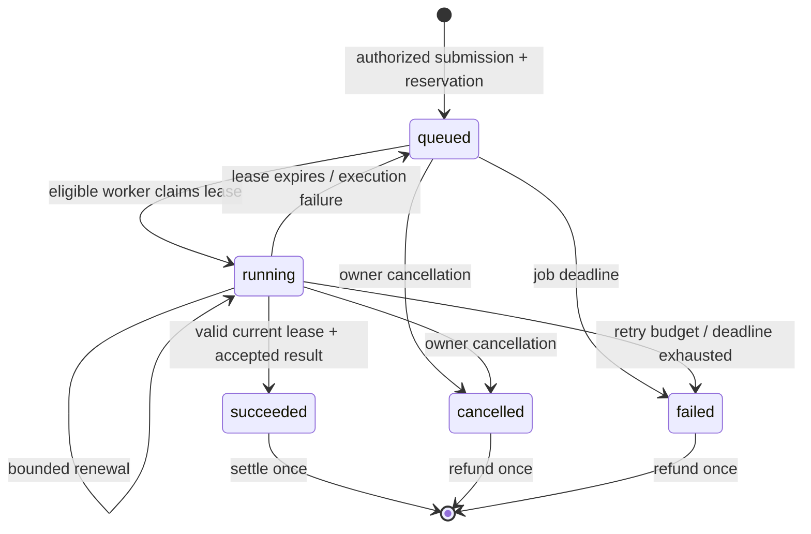

# Architecture

Status: v0.1 implementation and staged production design, 2026-10-16.

## Product boundary

Soapbox supplies resource admission, execution, scheduling, metering, and accounting.
Bitterbot supplies its desktop experience, agents, circle relationships, and eventual
wallet/mesh adapters. External clients use the same versioned protocol.

The first deployment is a **standalone service with a single coordinator per deployment**.
Workers are distributed; scheduling and settlement authority are centralized in v0.1.
Multiple authorities, mesh discovery, and federation require explicit later protocols.

## Modules and ownership

| Module | Current responsibility | Later extraction boundary |
|---|---|---|
| model | Versioned job, mode, workload, offer and receipt contracts | soapbox-protocol crate |
| config | Provisioned identities, roles and pool/project access | Identity and delegated admission |
| store | Atomic scheduler state, leases, quota and credit ledger | Scheduler and ledger services |
| api | Bounded authenticated HTTP interface | Partner-facing API |
| worker | Resource offers, polling, approved execution and renewal | Runtime-specific runners |
| main | Coordinator, worker and request CLI commands | Deployment binaries |

One Rust crate initially reduces protocol drift. Split crates when independent consumers
need them. There is no Bitterbot source dependency in the Rust workspace.

## Identity and policy

An operator provisions distinct credentials for each buyer, worker and administrator.
Configuration contains environment variable names; raw credentials are loaded at startup
and represented as SHA-256 digests in the coordinator. Comparisons are constant-time.
Credentials must be unique and at least 32 characters. Never share a worker identity across
concurrent machines: the scheduler gives each identity only one active lease.

Roles are separate from memberships. Admin grants credit issuance and operational visibility;
it does not automatically grant submission into private pools or collective projects.
Worker registration intersects claimed pool/project membership with coordinator ACLs.
The coordinator checks membership again when allocating a lease.

Bitterbot's existing personal-device node host is not a public execution worker.
Circle membership is not automatically trusted by Soapbox. v0.1 uses explicitly provisioned
pool IDs. Signed circle membership with revocation and expiry is a later adapter.

## Participation policies

| Mode | Admission | Accounting | Operator choice |
|---|---|---|---|
| Paid | Submitter role, sufficient test balance, maximum cost covers quote | Reserve fixed quote; settle on accepted completion; refund cancellation/final failure | Opt in and set minimum job price |
| Private | Buyer and worker belong to the same pool | Usage receipt, no money transfer | Explicit pool membership |
| Collective | Buyer and worker belong to approved project | Per-submitter/project UTC-day input quota and usage receipt | Explicit project opt-in |

One resource offer can permit multiple modes, but a single execution slot cannot be leased
twice. v0.1 scheduling is FIFO among eligible jobs. Weighted priorities, reserve shares and
fairness between tenants are required before broad public use.

Collective allowance counts admitted input items, including later cancelled/failed jobs,
to prevent cancellation-based quota bypass. Retries do not consume additional allowance.
This is a small pilot quota, not a future CPU/GPU-seconds pricing model.

## Job lifecycle

All scheduler changes and associated balance changes commit in one SQLite transaction.
Requests are serialized through the store mutex; SQLite also serializes file writes.
A unique (owner, idempotency_key) binds a retry to its exact original specification.
Completion retries must have the same lease and identical result; they cannot pay twice.

Leases last 30 seconds, renew every 8 seconds, and have a 120-second attempt cap.
Jobs expire after 10 minutes and have at most three attempts. Stale heartbeats
prevent new leases. Background maintenance runs every five seconds.

Cancellation invalidates result acceptance immediately. The worker detects it at renewal
and drops its in-flight request. An external model server may continue already-started work;
physical cancellation and GPU accounting are not guaranteed by the Ollama adapter.

## Resources and execution

v0.1 workers expose one CPU execution slot, a configured RAM admission allowance,
a list of allowed loaded models, and observed GPU residency. Actual available memory is
sampled before offers. A pause file or inadequate available memory suppresses new work.

SHA-256 jobs accept 1–128 strings and at most 256 KiB combined UTF-8 input. They do not
execute user commands. Embeddings use only the operator's exact configured model name at
127.0.0.1:11434; buyers cannot choose a URL, pull a model, mount files, or supply shell code.

A future resource descriptor must include CPU ISA/cores, physical RAM, GPU vendor/model/
VRAM/driver/backend, storage class/free space/IOPS, bandwidth, location assurance and
availability windows. Device benchmarks have timestamps and expiry. Distinguish detected,
benchmarked and attested values. Never aggregate unrelated VRAM as if it were shared memory.

Later general compute requires immutable workload artifacts and a sandbox with deny-by-default
network/filesystem access, CPU/memory limits, GPU device assignment, timeout and kill semantics.
Containers alone do not provide a sufficient hostile multi-tenant boundary.

## Acceptance, receipts and economics

SHA-256 output is recomputed by the coordinator, useful for exercising the transaction path.
Embedding output is checked for count, dimensions and finite values. Its receipt says
shape_only_trusted_worker; it is not proof that the claimed model or GPU was used.

Receipts record job/worker/mode, result hash, observed elapsed seconds, acceptance assurance
and charged credits. They are coordinator records with no cryptographic signature in v0.1.
Fixed input-item pricing avoids pretending self-reported utilization is trustworthy billing.

A real payment adapter must implement reserve, capture, release and reconcile with durable
idempotency and a recovery outbox. Wallet balance attestations alone are not escrow.
Real USDC settlement must reuse Bitterbot wallet policies without embedding wallet keys
in Soapbox workers. External provider receipts require independent reconciliation.

## Data and storage

Inline job inputs/results are authorized data. Status lists omit large result bodies;
fetch one job to retrieve its full result and receipt. Inputs remain in job records.
Operators must use nonsensitive pilot inputs and protect the database.

Artifacts are owner-scoped UTF-8 text, capped at 1 MiB/object, with 60–86400 second TTL
and a configurable account byte quota. They are temporary coordinator storage, not
distributed storage. Expiry removes live database records; SQLite/WAL/backups may retain
bytes. No secure-erasure claim is made.

Phase 3 separates encrypted bulk blobs from job/control messages and adds content addressing,
replication or erasure coding, audits, repair, placement constraints and departure protocols.
Do not promise durable storage on nodes that only commit spare capacity until their next reboot.

## Bitterbot and partner boundaries

Bitterbot gateway authenticates desktop calls, then uses a server-side Soapbox credential.
The renderer never receives a service token. Integrations are disabled unless configured.
Gateway-owned child processes are stopped at gateway shutdown; external services are untouched.
Workers require a separate opt-in setting.

Existing libp2p gossip can eventually advertise short, signed, expiring capacity descriptors.
Job payloads, datasets and secrets must not go over public gossip. Direct authenticated data
channels require binding the advertised peer identity to the endpoint and job authorization.
Current v0.1 does not publish any mesh advertisements.

Liquid Compute and Cognitum integrate through adapters using API v1. Neither partner's
commercial assumptions, identity scheme or proprietary runtime becomes a core dependency.
