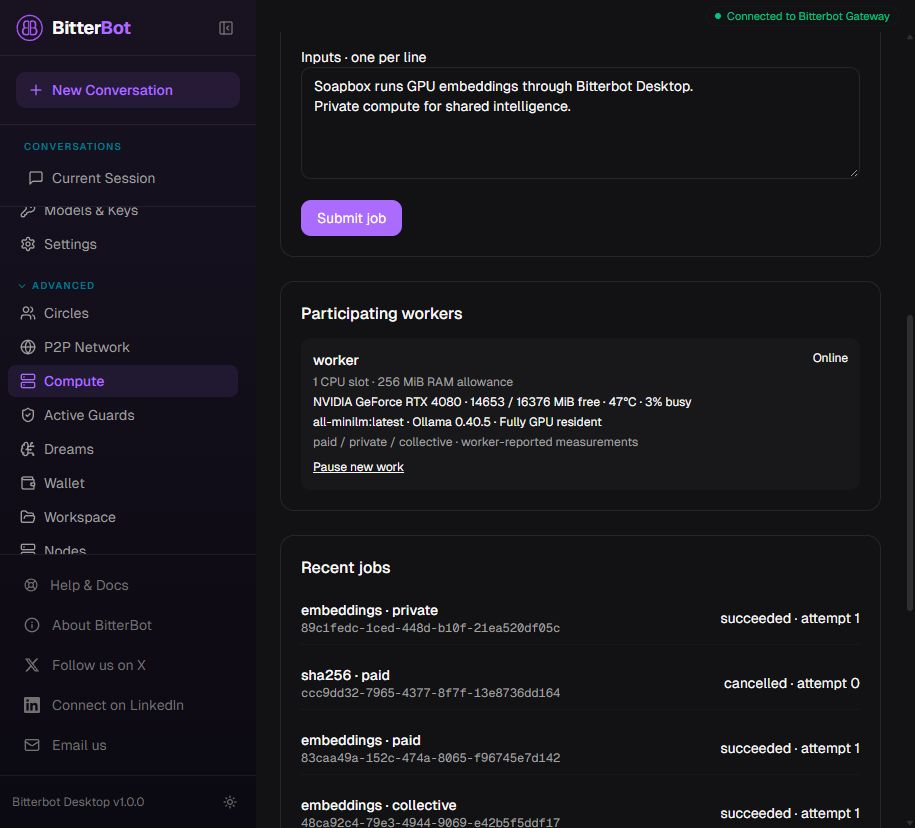

# Phase 2 GPU validation

> Current isolation and USDC extension: [Phase 2 isolation and payments](PHASE-2-ISOLATION-PAYMENTS.md). Earlier TEST_CREDIT/shared-host descriptions below refer to the original pilot.

Date: 2026-10-16. Soapbox 0.2.0, native Windows x64 development binary.
This record supplements the historical Phase 1 record in VALIDATION.md.

## Physical hardware and runtime

- NVIDIA GeForce RTX 4080, 16,376 MiB reported VRAM, driver 610.88.
- Official portable Ollama 0.40.5; downloaded archive SHA-256 checked against GitHub release metadata.
- Local CUDA backend. Ollama's server log reported "offloaded 7/7 layers to GPU".
- all-minilm:latest manifest digest:
  `1b226e2802dbb772b5fc32a58f103ca1804ef7501331012de126ab22f67475ef`.
- Observed model allocation: 27,137,146 bytes, all GPU resident; embeddings have 384 dimensions.
- No external inference or payment provider was used.

## Live gateway test

[Machine-readable receipts](evidence/gpu-validation-2026-10-16.json) come from the final
one-command launcher test at 2026-10-16T21:05:49Z. It started the runtime, coordinator,
worker and actual Bitterbot gateway, authenticated a WebSocket client, completed all jobs
and exited successfully. Temporary credentials/configuration were isolated from the user's
normal gateway. The gateway used its minimal test profile to disable unrelated subsystems.

| Mode | Inputs | Inference batches | Dimensions | Worker wall time | Test credits |
|---|---:|---:|---:|---:|---:|
| Private | 33 | 3 | 384 | 287 ms | 0 |
| Collective | 33 | 3 | 384 | 129 ms | 0 |
| Paid | 33 | 3 | 384 | 149 ms | 33 |

For each job, the first returned vector was compared with a separate direct Ollama call:
maximum absolute difference was zero. All vectors were checked for finite values and shape.
This is a regression comparison to the same model/runtime, not independent semantic validation.

The buyer started at 100 TEST_CREDIT, ended at 67, and had zero reserved credits.
A queued paid job was cancelled and refunded. Temporary artifacts round-tripped.
Pause/resume, service ownership and clean shutdown were exercised. No test workers, gateways
or inference runtimes were left running.

These are short functional runs on a warm local model, not a sustained benchmark or SLA.
Worker wall time excludes queue delay, model preparation, gateway/network and settlement
overhead. Earlier cold execution was slower. No claim about fleet capacity, energy cost,
multi-GPU scaling, GPU-second billing or customer throughput follows from these timings.

## Desktop browser check

The production renderer was served by the isolated gateway and opened in the Codex browser.
Advanced > Compute displayed the physical RTX 4080, free VRAM, temperature, utilization,
the pinned model and full residency. A private GPU job with two text inputs was submitted
through the actual form. Its selected result automatically progressed from queued to succeeded,
with two 384-dimensional vectors and runtime evidence.

Job ID: `89c1fedc-1ced-448d-b10f-21ea520df05c`; one batch, 2,800 ms worker wall time.
The screenshot shows the GPU worker and completed jobs:

The isolated gateway's unrelated Circles/management widgets emitted unavailable notices
because those subsystems were disabled. The Compute submission/result path succeeded.
This is a browser renderer check, not an installed Tauri shell or signed installer test.

## Automated validation

- Rust: **25 tests passed**, including six worker/runtime tests, sixteen lifecycle/settlement
  tests and three HTTP/multi-process tests.
- Rust format check and Clippy across all targets: passed, warnings denied.
- Windows cross-build and native `soapbox --version`: passed (0.2.0).
- Bitterbot client/RPC/scope tests: **10 passed**.
- Compute renderer tests: **5 passed**, including pinned GPU submission, missing readiness
  and automatic selected-result refresh.
- Gateway TypeScript and desktop TypeScript: passed.
- Targeted type-aware lint: passed, no warnings/errors.
- Desktop text-size, key-display and file-size guards: passed.
- Production Vite build: passed, 4,504 modules; existing large-chunk warnings remain.
- Native CPU managed-service regression test: passed.
- Native GPU gateway test: passed repeatedly, including final owned-runtime startup/cleanup.
- Pinned setup is repeatable with the model cached and no model-registry request on repeat runs.

Failure coverage includes wrong/missing model digests, CPU fallback, lost GPU residency,
unavailable NVIDIA telemetry, hot/busy/low-memory GPU admission, result count/order,
missing evidence before settlement, duplicate completion, cancellation/refund, stale leases,
retry exhaustion, pool isolation, collective quotas and persistence.

The full Bitterbot test suite, remote CI, WAN fleets, AMD/Metal hardware, real payments,
hard resource isolation and an independent security review were not run or delivered.
